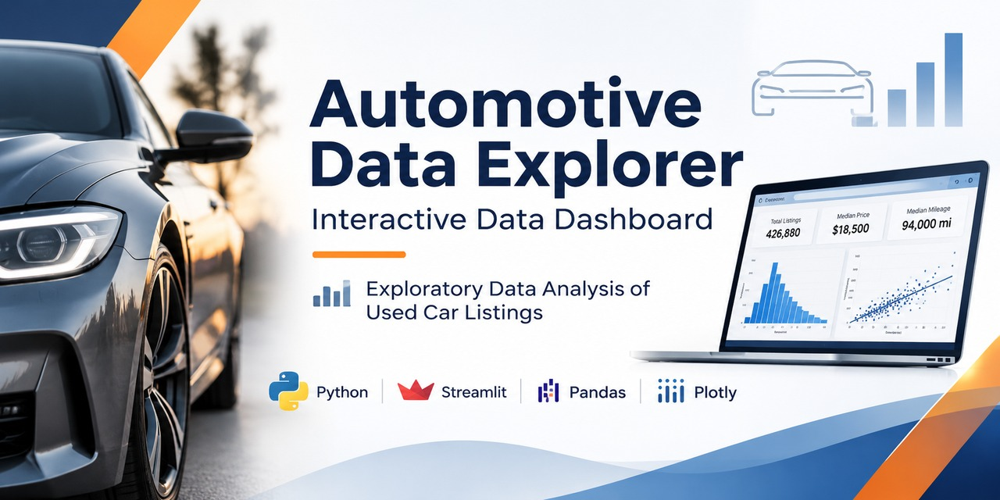

<p align="center">
  
</p>

# Automotive Data Explorer — Interactive Dashboard

**Author:** Ana Paula Takezawa  
**Education:** MBA in Data Science and Artificial Intelligence — TripleTen Brasil

[(https://my-new-repo-vbxl.onrender.com)](https://my-new-repo-vbxl.onrender.com?utm_source=chatgpt.com)
Live Demo: Access the Interactive Dashboard
---

## Project Overview

This project consists of developing an interactive web application to explore and visualize used vehicle advertisement data from the United States.

Built with Python, Streamlit, and Plotly, the application provides interactive data visualizations that help users explore distributions and relationships between vehicle attributes.

The project was originally developed as part of the Software Development Tools module of the Data Science program at TripleTen Brasil, with a focus on applying software engineering practices to data projects.

## Project Objectives

- Develop an interactive web application using Streamlit.
- Perform exploratory data analysis (EDA).
- Create interactive data visualizations with Plotly Express.
- Manipulate and explore datasets using Pandas.
- Manage Python environments and project dependencies.
- Deploy a Python application to a cloud platform.

## Dashboard Features

The application was designed to provide interactive visual exploration of vehicle advertisement data.

Its core visualizations include:

- **Histogram:** Explore the distribution of numerical vehicle attributes.
- **Scatter Plot:** Investigate relationships between numerical variables.
- **Interactive Controls:** Generate visualizations through user interactions.

## Technologies & Tools

| Technology | Application |
|---|---|
| Python | Programming language |
| Pandas | Data manipulation |
| Plotly Express | Interactive data visualization |
| Streamlit | Web application development |
| Jupyter Notebook | Exploratory data analysis |
| Git & GitHub | Version control and project management |
| Render | Cloud deployment |

## Project Workflow

1. **Environment Setup:** Created and managed a Python virtual environment.
2. **Data Exploration:** Loaded the dataset and performed exploratory analysis using Pandas.
3. **Data Visualization:** Developed histograms and scatter plots using Plotly Express.
4. **Application Development:** Built an interactive web dashboard with Streamlit.
5. **Deployment:** Prepared and deployed the application using Render.

## Repository Structure

```text
app_render/
│
├── README.md
├── app.py
├── requirements.txt
├── vehicles_us.csv
├── .gitignore
│
├── notebooks/
│   └── EDA.ipynb
│
└── streamlit/
    └── config.toml
```

*Note: The structure above represents the intended project organization. Adjust file names and folders to match the actual repository.*

## How to Run Locally

Clone the repository:

```bash
git clone https://github.com/anapaula-takezawa/app_render.git
```

Navigate to the project directory:

```bash
cd app_render
```

Create and activate a virtual environment:

```bash
python -m venv venv
```

Install the dependencies:

```bash
pip install -r requirements.txt
```

Run the Streamlit application:

```bash
streamlit run app.py
```

The application will be available at:

```text
http://localhost:8501
```

## Deployment

The application was developed for cloud deployment using Render.

**Live Application:** Add the public Render URL here once confirmed.

## Key Learnings

This project provided practical experience in:

- Python application development.
- Exploratory Data Analysis.
- Interactive data visualization.
- Web application development with Streamlit.
- Python environment and dependency management.
- Version control with Git and GitHub.
- Cloud application deployment.

## Author

**Ana Paula Takezawa**

MBA in Data Science and Artificial Intelligence — TripleTen Brasil

[GitHub](https://github.com/anapaula-takezawa)
